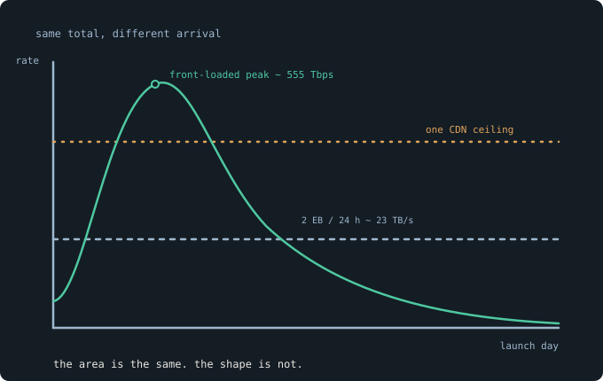
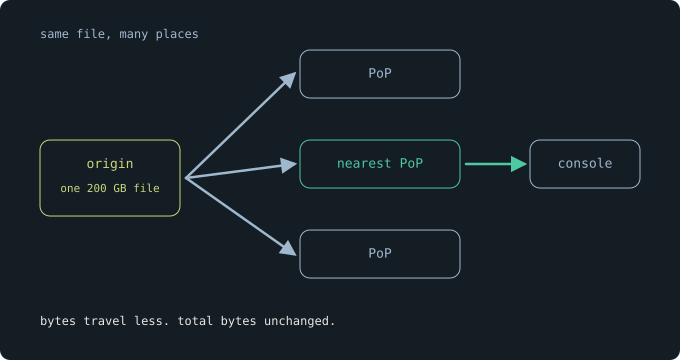
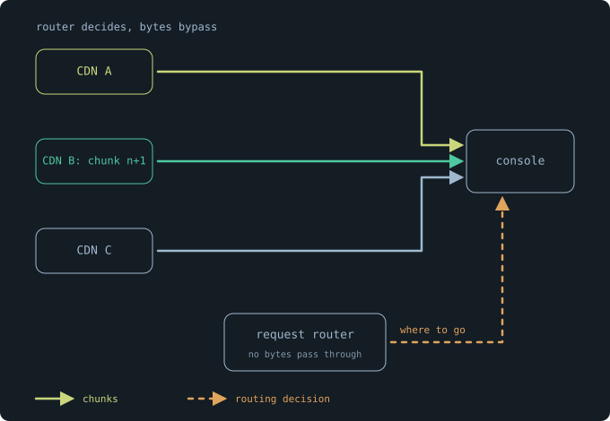
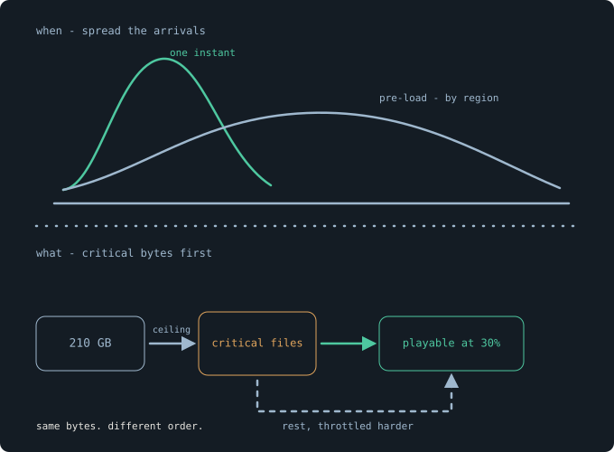
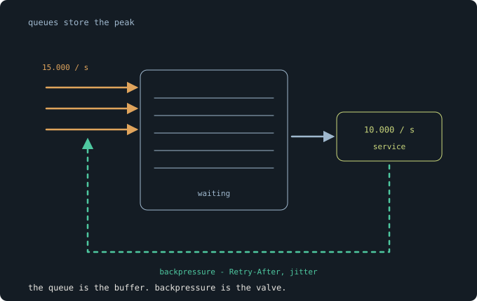
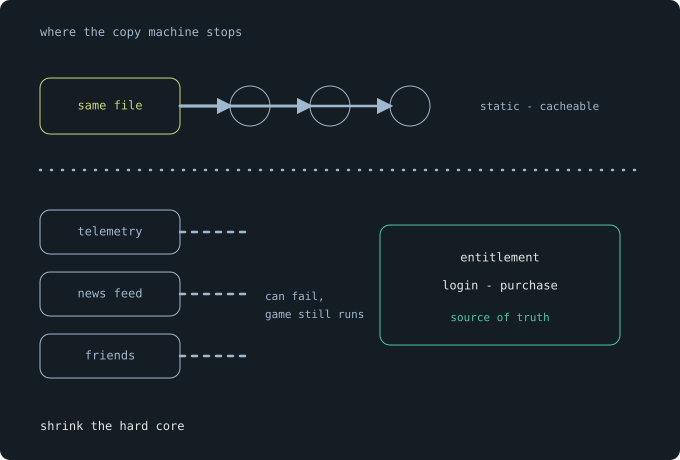

```js
const urls = Array.from(
  { length: 10_000 },
  (_, i) => `https://api.example.com/item/${i}`,
);

// sequential: safe, but slow
for (const url of urls) {
  await fetch(url);
}

// parallel: fast, but floods
await Promise.all(urls.map((url) => fetch(url)));
```

La primera versión es demasiado lenta. La segunda puede tumbar el servicio. Los mismos diez mil requests. El mismo trabajo total. Lo único que cambió es la forma en que llegan.

Ya habrás arreglado esto alguna vez. No agregaste un servidor más grande. Agregaste un límite de concurrencia, una cola, un batch. Cambiaste cuándo salen los requests, no cuántos son. El total quedó igual. La curva cambió.

Ahora escalá esa línea de código a un lanzamiento de juego.

Tomá GTA 6: diez millones de copias el día uno, alrededor de 210 GB cada una. Multiplicalo:

```text
10.000.000 copias × 210 GB = 2.100.000.000 GB
2.100.000.000 GB = 2.100.000 TB = 2.100 PB = 2.1 EB
```

Dos exabytes. Ese es el número que todos calculan. También es el número equivocado.

Dos exabytes es una cantidad. Las cantidades no tumban sistemas. Las tasas sí.

Repartí esos 2.1 exabytes en las primeras 24 horas y te da:

```text
2.100.000 TB / 86.400 s ≈ 24.31 TB/s
24.31 TB/s × 8 ≈ 194 Tbps
```

Eso ya es mucho. Pero el tráfico no se reparte parejo. Un lanzamiento es front-loaded: la mayoría intenta descargar en el momento en que el juego se desbloquea. Si la mitad de las descargas pasa en las primeras cuatro horas:

```text
1.050.000 TB / 14.400 s ≈ 72.92 TB/s
72.92 TB/s × 8 ≈ 583 Tbps
```

Y si el lanzamiento es un récord, la cantidad de copias podría ser 2 o 2.5 veces esa estimación. Ahora el número no es una cantidad. Es una tasa. Akamai, uno de los CDNs más grandes en gaming, reportó picos cercanos a 396 Tbps en 2025, con una capacidad de más de 1.000 Tbps. La estimación de 583 Tbps ya es más de la mitad de eso. El escenario récord está por encima. Ningún CDN solo carga con esto. Por eso la arquitectura es plural por defecto.



Esto es lo primero que enseña el lanzamiento: un sistema dimensionado para el promedio colapsa en el pico. El promedio es un número cómodo. El pico es el que llega.

Cada técnica del playbook de lanzamiento es una manera de cambiar la forma de esa curva. No el tamaño del total. La forma en que llegan.

La descarga en sí es la parte más simple, porque es el mismo archivo para todos. Eso es lo que hace posible el caching. Un CDN no reduce la cantidad de bytes; pone una copia de los bytes más cerca del usuario. El archivo está guardado en muchos lugares, y la consola descarga desde el más cercano. Cada ubicación es un point of presence, un PoP. El total no cambia. La distancia que recorre cada byte, sí.



El mismo movimiento va más lejos. Un CDN puede asociarse con un ISP y poner servidores dentro de la red del ISP, pasando el peering link, la frontera entre dos redes. La descarga se resuelve dentro del ISP sin salir a la internet pública. Los bytes siguen existiendo; solo que no tienen que viajar tanto. Esto solo tiene sentido para contenido extremadamente popular, porque estás pagando por poner una copia del mismo archivo en muchos lugares. GTA 6 es exactamente ese contenido.

Después está el caso de falla. Si dependés de un solo CDN, tenés un single point of failure: si se cae o se satura, la store queda bloqueada. Por eso usás varios CDNs en paralelo. Un request router decide cuál usa cada cliente, según la región, los weights configurados y las métricas de performance en tiempo real. El tráfico pesado no pasa por el router; el router solo le dice a la consola a dónde ir, y la consola descarga directo del CDN elegido. La descarga se parte en chunks, así que un chunk puede venir de un CDN y el siguiente de otro. Si un camino se degrada, el siguiente chunk toma otro. Los bytes son los mismos. Los caminos, no.



El caching cambia a dónde va el flujo. El siguiente grupo de técnicas cambia cuándo va.

Los pre-downloads son el ejemplo más claro. Si hacés la pre-order del juego, podés descargar los archivos días antes del lanzamiento. El juego queda bloqueado hasta la hora oficial, pero los bytes ya están en tu consola. Un pico masivo se convierte en una carga sostenida durante los días previos. La fecha de lanzamiento sigue sincronizando a los jugadores. La descarga no tiene por qué.

Los lanzamientos escalonados (staggered releases) hacen lo mismo a través de la geografía. En vez de desbloquear en todos lados en el mismo instante, desbloqueás a la medianoche local, o por país. El pico se convierte en una ola que viaja por el mundo en vez de un golpe simultáneo en todos lados. El trade-off es de negocio y de enforcement: los jugadores intentan falsificar su región para jugar antes, y bloquearlo estrictamente puede castigar a gente que realmente está viajando. La infraestructura quiere una curva suave. El negocio quiere un momento único y simultáneo. Los dos están tirando de la misma curva.

El throttling es la versión bruta. Le ponés un techo a cuánto ancho de banda o cuántos requests puede usar un cliente, para que el sistema nunca cruce el límite donde colapsa. La descarga tarda más, pero sigue moviéndose. Una velocidad más baja con movimiento continuo le gana a un colapso. Es la misma lógica que un limitador de audio: bajás el pico para que la señal no haga clipping, y la canción sigue sonando.

Las descargas parciales reordenan el flujo en vez de frenarlo. El juego marca primero los archivos críticos, así que se vuelve jugable al 30%. El resto se carga en segundo plano, y a ese tráfico de fondo se le puede aplicar un throttling más agresivo, dejando ancho de banda para los jugadores que recién arrancan. El total es el mismo. El orden, no.



Hay una forma más de cambiar: el buffer. Cuando las llegadas superan la tasa de servicio, ponés una cola entre medio. La cola absorbe la diferencia, y el sistema sigue sirviendo a su propio ritmo en vez de colapsar.

La aritmética es simple y brutal. Suponé que una base de datos puede manejar 100 conexiones concurrentes, con una latencia promedio de 10 milisegundos por query. Su throughput es:

```text
100 conexiones / 0.01 s = 10.000 queries por segundo
```

Ahora llega un pico de 15.000 requests por segundo y dura diez segundos. La base de datos sirve 10.000 por segundo y encola los otros 5.000. Después de diez segundos, hay 50.000 requests esperando. Si las llegadas se detuvieran ahí, drenar la cola a capacidad tomaría cinco segundos:

```text
50.000 / 10.000 = 5 s
```

Pero las llegadas no se detienen. Si siguen llegando a 15.000 por segundo, la cola no drena. Crece. La espera crece con ella. Little's Law nombra esa relación: la cantidad de requests en el sistema es la tasa de llegada por el tiempo que cada uno pasa ahí. Mantené las llegadas por encima de la tasa de servicio y la cola y la espera crecen juntas. Esta es la parte que la gente se pierde de las colas: no cancelan un pico, lo almacenan. Te compran tiempo, y solo te lo devuelven si la tasa de llegada cae por debajo de la tasa de servicio. Si no cae, la cola es solo una forma más lenta de fallar.

Por eso una cola nunca alcanza por sí sola. También necesitás backpressure: retries con exponential backoff, jitter, un header `Retry-After`, rate limiting, circuit breakers. El cliente tiene que frenar, y el servidor tiene que hacerlo cumplir, porque no podés confiar en que el cliente respete una pausa que no puede ver. La cola es el buffer. El backpressure es la válvula.



Todo lo anterior fue la capa estática. El mismo archivo para todos. El CDN es una fotocopiadora, y las fotocopiadoras escalan porque a los bytes no les importa quién pregunta. Por eso la descarga es la parte que se puede hacer parecer fácil.

En el momento en que el request depende de quién sos, la fotocopiadora se detiene. Compraste el juego? Es esta tu cuenta? Esta compra se confirma? Esas preguntas no las puede responder una copia del archivo en el edge. Necesitan una fuente de verdad, y la fuente de verdad tiene que coincidir consigo misma.

Esta es la hard dependency. La descarga puede terminar perfecto y el juego igual no arranca, porque el servicio que verifica si lo compraste está caído. O porque los servidores de login del estudio están caídos. El Error 37 de Diablo III es la versión canónica: el juego estaba instalado, los servidores no dejaban entrar a nadie. El flujo estático estaba bien. El núcleo stateful era la falla.

El marco de flujo explica la capa estática. Acá se rompe. No podés cachear un permiso de la misma forma en que cacheás un archivo. Podés cachearlo por un tiempo, pero el cache tiene que expirar, y cuando expira, la respuesta tiene que ser correcta. Podés encolar el chequeo, pero ahora la cola está en el critical path: el jugador no puede arrancar hasta que el chequeo se resuelva. Podés aplicar throttling a la descarga y también a un login, pero no son el mismo tipo de espera. Hacer throttling de bytes es invisible: la descarga solo tarda más. Hacer throttling de un login queda en el critical path, porque el usuario no está esperando bytes; está esperando jugar.

El principio de diseño es achicar el núcleo. Casi todo debería ser una soft dependency: si falla la telemetry, el juego sigue; si falla el feed de noticias, el juego sigue; si falla la lista de amigos, el juego sigue. Las hard dependencies son las pocas cosas que tienen que estar correctas para que el juego arranque: entitlement, login, la compra misma. Esas llevan la redundancia, la strong consistency y la atención de ingeniería. El resto lleva una cola y un encogimiento de hombros.



Acá también es donde la elección de base de datos deja de ser un debate abstracto. Una base NoSQL puede escalar horizontalmente, pero te obliga a diseñar alrededor de los patrones de acceso; si consultás por usuario y por juego, duplicás los datos en vistas que tardan en coincidir. Esa eventual consistency está bien para un feed social. No está bien para la propiedad. Sony migró sus datos de entitlement de Cassandra a Google Spanner exactamente por esto: escala horizontal con strong consistency, y una reducción reportada del 91% en almacenamiento porque ya no tenía que duplicar los datos en distintas vistas. La capa stateful no es un problema de flujo. Es un problema de verdad.

Volvé a los diez mil URLs.

El arreglo no fue un servidor más grande. Fue una cantidad más chica de requests en vuelo al mismo tiempo. Un límite de concurrencia. Una cola. Un batch. El total quedó igual. La forma cambió.

Un lanzamiento es el mismo arreglo a la escala de un planeta. Dos exabytes no es el problema. El problema es la derivada: la tasa a la que llega la multitud. Y la multitud llega a esa tasa porque el lanzamiento le dijo que lo hiciera. Una fecha de lanzamiento es una tecnología de sincronización. La infraestructura es una tecnología de desincronización. Pre-downloads, staggered releases, throttling, descargas parciales, colas, batches: todas son formas de romper la misma promesa sin que el jugador lo note. El juego sigue sintiéndose como si arrancara en el mismo momento para todos. Los bytes, no.

El número que importa no es el total. Es la forma de la curva. Y la curva está hecha de gente que decidió aparecer en el mismo minuto.

**Fuentes**

- [Akamai, "2025 Impact Report" (pico de tráfico de 2025: 395.84 Tbps)](https://www.akamai.com/content/dam/site/en/documents/research-paper/2026/2025-impact-report.pdf)
- [Akamai, "Secure Every AI Interaction" (más de 1.000 Tbps de capacidad)](https://www.akamai.com/site/es/documents/brief/2023/akamai-prolexic-product-brief.pdf)
- [Google Cloud, "Game on with Spanner: How Playstation achieves global scale with 91% less storage, 50% lower costs" (archivado)](https://web.archive.org/web/20260309162044/https://cloud.google.com/blog/products/gaming/sony-interactive-playstation-games-library-spanner-heroes)
- [GDC Vault, "Leveling Up with Google Cloud: PlayStation's Global Migration to Spanner" (Presented by Google Cloud)](https://gdcvault.com/play/1035649/Leveling-Up-with-Google-Cloud)

*Nota: este es un análisis de los patrones generales detrás de un lanzamiento, no una descripción de la arquitectura real de Rockstar. Las cifras de tráfico salen de un modelo con datos públicos, no de mediciones del lanzamiento. Las técnicas son el playbook estándar; lo que discuto es el marco, no la implementación.*
