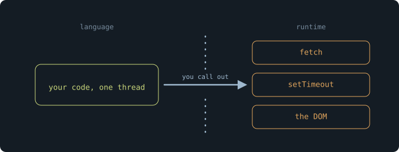
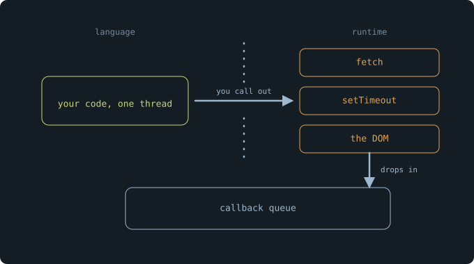
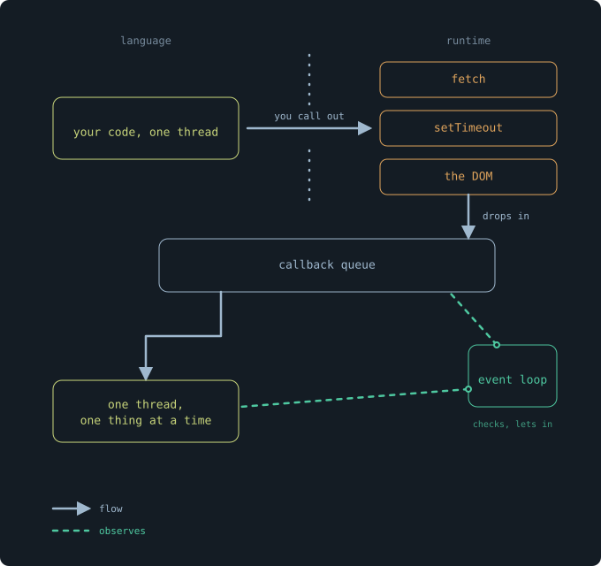
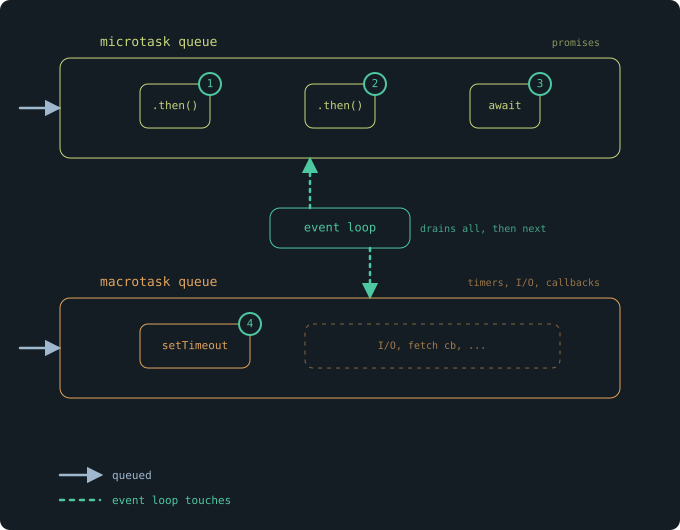

Acá tenés un programa. Leelo y predecí la salida antes de ejecutarlo.

```js
console.log("first");

Promise.resolve().then(() => {
  console.log("second");
});

console.log("third");
```

Si dijiste `first`, `second`, `third`, leíste el código como está escrito: de arriba hacia abajo. Pero eso no es lo que se ejecuta. La salida es `first`, `third`, `second`.

La línea que escribiste segunda se ejecutó última. Acá no hay nada roto. Es JavaScript haciendo exactamente lo que está diseñado para hacer. La pregunta es _qué_ está diseñado para hacer, porque claramente no es "ejecutar cada línea en orden".

Ahora agregá un `await`:

```js
async function load() {
  console.log("start");
  await fetchUser();
  console.log("done");
}
```

El `await` no solo pausa `load`. Devuelve el control, deja que corra otro código y retoma donde había quedado cuando `fetchUser` se resuelve. Un solo thread abandonó una función sin terminar, hizo otro trabajo y volvió para terminarla.

Y esa es la parte que debería molestarte. JavaScript es single-threaded. Un thread hace una cosa a la vez. Sin embargo, este único thread empieza una función, se va, ejecuta otra cosa y vuelve. Tu navegador descarga tres imágenes, responde a tus clics y corre una animación, todo mientras este código espera.

Entonces una de dos cosas es cierta. O JavaScript no es realmente single-threaded, o "una cosa a la vez" no significa lo que creés que significa.

Es la segunda. Y para ver por qué, hay que separar dos palabras que la mayoría de los desarrolladores usa como si fueran la misma: _concurrencia_ y _paralelismo_.

El thread nunca hace dos cosas en el mismo instante. Mirá el `await` de nuevo: ejecuta `load`, se aparta, ejecuta otra cosa, vuelve. En ningún momento hay dos líneas de tu código ejecutándose a la vez. Siempre está pasando exactamente una cosa.

Pero a lo largo del tiempo, hay dos cosas _en curso_. `load` no terminó, y aun así otro trabajo avanza mientras espera. Una tarea en cada instante, muchas tareas en marcha.

Esa brecha tiene dos nombres. Manejar varias tareas intercalándolas en un solo worker es **concurrencia**. Ejecutar varias tareas en el mismo instante literal, en workers separados, es **paralelismo**. JavaScript te da lo primero y nunca lo segundo.

Un solo cajero lo vuelve concreto. Un cajero, dos filas. Empieza a cobrarle a un cliente de la fila A, y mientras ese cliente busca la tarjeta, se da vuelta y escanea un producto de la fila B, y después vuelve. Las dos filas avanzan. Un solo trabajador, alternando. Eso es concurrencia. Paralelismo es que abra una segunda caja: dos cajeros, dos clientes, el mismo segundo. Eso necesita un recurso que JavaScript no tiene: un segundo thread ejecutando tu código.

Esto es lo que ganás a cambio. Con un solo cajero, nunca hay dos manos metiéndose en la misma caja a la vez. Nada queda a medio actualizar por otro mientras estás en mitad de una transacción. Que haya un solo thread es la razón por la que el estado de tu JavaScript es predecible, por la que nunca protegés una variable de que otra línea de tu propio código la cambie por debajo. Los lenguajes con paralelismo real lo pagan con locks, race conditions y toda una categoría de bugs en la que, en JavaScript, simplemente nunca tuviste que pensar.

Tener un solo thread no es la limitación que el event loop rodea. Es la decisión de diseño que el event loop existe para proteger.



Entonces, quién descarga las imágenes?

Tu código no. Tu código las pidió y siguió de largo. Otra cosa hizo la descarga real, en algún otro thread, mientras tu único thread seguía avanzando. La pregunta es qué es esa otra cosa, y dónde vive.

Empecemos por `fetch`, ya que fue lo que pidió las imágenes. Dónde está definido `fetch`?

No en JavaScript. Abrí la especificación de ECMAScript, el documento que define el lenguaje en sí, y buscá `fetch`. No está. Tampoco `setTimeout`. Tampoco `document`, ni `localStorage`, ni el DOM entero. El lenguaje que creés estar escribiendo no incluye las funciones que más usás.

Vienen de otro lado. `fetch` lo define el navegador. `setTimeout` también. En el servidor, Node provee sus propias versiones. Esto es el **runtime**: el entorno que ejecuta tu JavaScript y le da un conjunto de capacidades que el lenguaje nunca tuvo por sí solo. Tu código vive de un lado de una línea. `fetch`, `setTimeout`, el DOM, toda la maquinaria que toca la red, el reloj, la pantalla, vive del otro.

Esa línea es toda la respuesta.

Cuando llamás a `fetch`, no estás ejecutando JavaScript que descarga un archivo. Estás llamando a través de la línea, pidiéndole al runtime que lo haga. El runtime tiene recursos que tu thread no tiene: threads en segundo plano, escritos en C++, que pueden quedarse esperando en un socket de red sin bloquear nada. Arranca la descarga allá y te devuelve el control de inmediato. Tu thread nunca esperó. No podía. Le delegó la espera a algo construido para esperar.

Por eso la contradicción del principio se disuelve. Tu único thread nunca descargó tres imágenes a la vez. Se lo pidió tres veces al runtime, y el runtime, que no está atado a tu único thread, hizo la espera en paralelo. El paralelismo existe. Solo que no existe en tu código. Vive del otro lado de la línea, en una maquinaria que no es JavaScript en absoluto.

Queda un problema. La descarga termina allá, en algún thread en segundo plano. Tu callback necesita ejecutarse acá, en tu thread, en tu código. Cómo vuelve el resultado a este lado de la línea?



No vuelve solo. Esa es la parte que la gente entiende mal.

Cuando la descarga termina, el runtime no se mete en tu thread a ejecutar tu callback. No puede. Tu thread podría estar en medio de algo, e interrumpirlo rompería la única garantía que hace predecible a JavaScript: que nada toca tu estado mientras una parte de tu código se está ejecutando. El runtime respeta la línea en las dos direcciones. Hizo el trabajo allá, y ahora necesita esperar a que tu thread esté libre para que tu código pueda continuar.

Entonces el resultado terminado va a una cola. Y espera.

Tu thread, mientras tanto, está ejecutando lo que sea que estaba ejecutando, de arriba hacia abajo, una cosa a la vez, exactamente igual que antes. Cuando termina y no le queda nada por hacer, queda libre. Algo tiene que darse cuenta de que está libre, sacar de la cola el siguiente callback que espera y dárselo al thread.

Ese algo es el event loop.

Eso es todo lo que es. No es un motor. No ejecuta tu código: eso lo hace el thread. No descarga nada: eso lo hace el runtime. No decide qué significa tu programa. Hace una sola cosa, chica y mecánica, una y otra vez: fijarse si el thread está libre y, si lo está, tomar el siguiente elemento de la cola y dejarlo correr. Fijarse, y dejar pasar. Fijarse, y dejar pasar. Un loop que vigila una cola y un thread, y los conecta en el único momento en que es seguro hacerlo.

El nombre lo sobrevende. "Event loop" suena al núcleo de todo el sistema, el motor en el centro. Se parece más a un portero. El thread hace el trabajo. El runtime hace la espera. La cola guarda los resultados. El event loop solo vigila la puerta y deja pasar al siguiente cuando la sala está vacía.

Y este es el modelo, completo. Tu código corre en un thread. Cuando necesita algo que el lenguaje no puede hacer, llama a través de la línea al runtime, que hace el trabajo en sus propios threads y deja el resultado en una cola. El event loop espera a que tu thread quede inactivo y después le pasa el siguiente resultado. Un thread, nunca interrumpido, que nunca comparte su estado, alimentado con un flujo constante de trabajo por un loop cuya única función es elegir el momento.

Y eso debería dejarte una pregunta, si volvés a donde empezamos.



Volvé al primer programa.

```js
console.log("first");

Promise.resolve().then(() => {
  console.log("second");
});

console.log("third");
```

Ahora sabés por qué `second` espera. El callback de `.then` no se ejecuta en línea; va a la cola, y el event loop solo se lo pasa al thread cuando el código actual terminó. `first`, `third`, después `second`. El modelo lo explica.

Salvo que el modelo no lo explica todo. Agregá una línea:

```js
console.log("first");

setTimeout(() => console.log("timeout"), 0);

Promise.resolve().then(() => console.log("promise"));

console.log("third");
```

`setTimeout` con un delay de cero. Pide ejecutarse lo antes posible, y lo pide _antes_ que la promise, dos líneas más arriba. Los dos callbacks están esperando cuando termina el código sincrónico. Los dos están listos. El thread queda inactivo. El event loop mira la cola.

La salida es `first`, `third`, `promise`, `timeout`.

Gana la promise. Se registró segunda, no pide ningún delay frente a un timer que tampoco pidió ninguno, y aun así se ejecuta primero. Si el event loop simplemente sacara de una sola cola en orden de llegada, esto no podría pasar.

No saca de una sola cola. Hay dos.

Los callbacks de las promises van a una fila, que suele llamarse microtask queue. Los timers, el I/O, los callbacks que el runtime devuelve desde `fetch`, van a otra, la macrotask queue. Y el event loop no las trata por igual. Después de cada macrotask, antes de tocar la siguiente, vacía la microtask queue completa. Se ejecuta cada callback de promise pendiente, y también cualquier promise que _ellos_ agenden, todo, antes de que un solo timer tenga su turno.

Así que el timer nunca tuvo chance. `setTimeout(fn, 0)` no significa "ejecutá esto ahora". Significa "ponelo en la fila lenta". La promise estuvo en la fila rápida todo el tiempo.



Esa es toda la razón por la que el orden parecía equivocado al principio. No porque JavaScript sea impredecible. Porque es _exactamente_ predecible, según reglas que nunca fueron visibles en el código. El thread único, la línea entre lenguaje y runtime, la cola, el loop, y ahora dos carriles a través de él con una prioridad estricta entre ellos. Nada de eso está en el código fuente. Todo eso decide lo que hace tu código fuente.

Nunca estuviste leyendo mal el programa. Estabas leyendo solo la mitad. La otra mitad es la máquina de abajo, y estuvo siguiendo sus reglas al pie de la letra, todo el tiempo.

_Una nota sobre este post: antes vivió acá una versión anterior, y no era buena. Explicaba el event loop como lo hacen la mayoría de los posts, como un mecanismo para memorizar, y nunca tocaba la única pregunta que hace que todo encaje: por qué cualquiera de estas cosas tiene que funcionar así. Así que lo reescribí desde cero._

